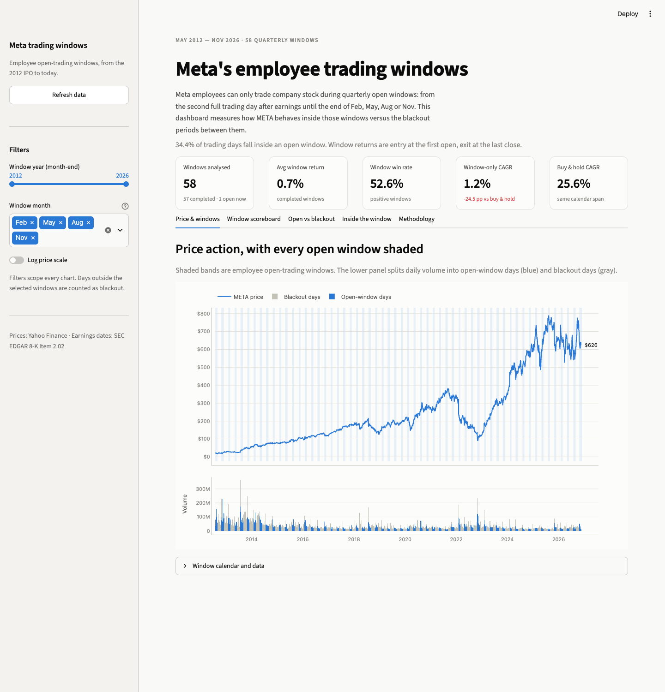
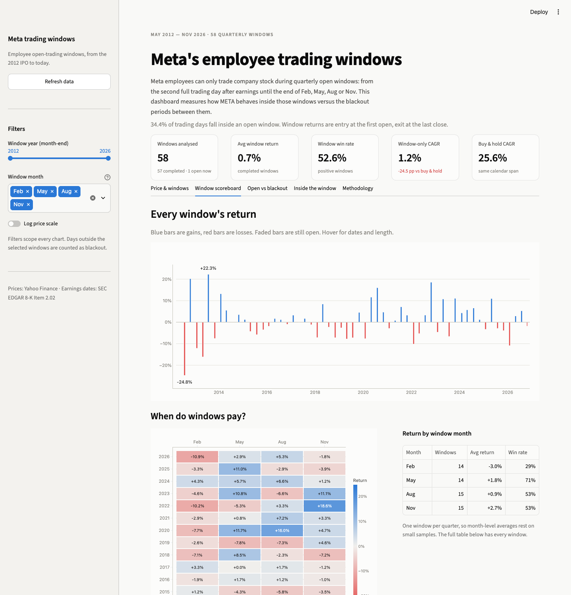
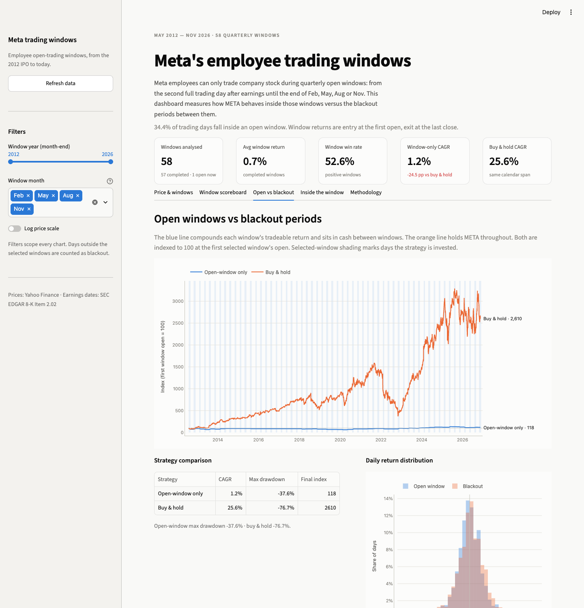

# Meta employee trading windows

A Streamlit dashboard analysing how Meta's stock behaves **inside its quarterly
employee open-trading windows** versus the blackout periods in between — over the
full history since the May 2012 IPO, not just the last ten years.

<p align="center">
  
</p>

## What a trading window is

Meta's insider-trading policy puts employees in a **closed trading period** that
starts at market close on the last day of the middle month of each quarter
(February, May, August, November). The window reopens on the **second full
trading day after the quarterly earnings release** and stays open until the next
middle-month close.

The dashboard derives the calendar from Meta's actual filings:

1. Every quarterly earnings release is identified from the company's **SEC Form
   8-K with Item 2.02** (results of operations).
2. The window opens on the second trading day strictly after that filing date.
3. It closes on the last trading day on or before the next Feb/May/Aug/Nov
   month-end. If that date is in the future, the window is marked **open now**.

Sources: [Meta 2024 Form 10-K](https://d18rn0p25nwr6d.cloudfront.net/CIK-0001326801/5e0f2f01-cd4e-4252-afe5-4052117d5c93.html#28)
and Meta's Code of Conduct. This yields **58 windows** from August 2012 through
November 2026.

## What the dashboard shows

| Tab | Contents |
|---|---|
| **Price & windows** | Full-price history with all open windows shaded, plus daily volume split into open-window and blackout days |
| **Window scoreboard** | Every window's return, drawdown, volatility, range and volume; year × month heatmap; sortable detail table |
| **Open vs blackout** | Open-window-only equity curve vs buy & hold, regime statistics, daily return distributions |
| **Inside the window** | All 58 normalised price paths, median path, latest window, average return by day-in-window, volume vs the prior 60 days |
| **Methodology** | Policy definition, data sources, metric formulas and caveats |

<p align="center">
  
  
</p>

### Headline results (data through 16 Nov 2026)

- **58 quarterly windows** — 57 completed, one (Nov 2026) still open. Open
  windows cover **34%** of all trading days.
- The average completed window returned **+0.7%**; **52.6%** of windows were
  positive.
- A strategy that holds META **only during open windows** compounds to **+18%**
  (1.2% CAGR) over the period, versus **2,610** (+25.6% CAGR) for buy & hold.
  The window-only strategy is in cash two-thirds of the time, so its max
  drawdown is **−37.6%** versus **−76.7%** for buy & hold.
- Daily volatility is lower inside windows (**32.2%** annualised) than in
  blackout periods (**43.4%**). The largest single-day moves — earnings
  reactions — fall in blackout periods by construction.
- February is the weakest window month by average return (−3.0%, 29% win rate);
  May has the highest hit rate (71%).

The app recomputes all of these from the selected filters.

## Quickstart

```bash
git clone https://github.com/ZiyueWangUoB/meta-trading-window-dashboard.git
cd meta-trading-window-dashboard
python3 -m venv .venv
source .venv/bin/activate
pip install -r requirements.txt
streamlit run app.py
```

The first load fetches two public sources and caches them in `.cache/`:

- **Earnings dates:** [SEC EDGAR submissions API](https://data.sec.gov/submissions/CIK0001326801.json),
  filtering 8-K filings with Item 2.02. Cached for 7 days.
- **Prices:** Yahoo Finance daily chart API for META (ticker FB before October
  2021), dividend-adjusted. Cached for 12 hours.

Use the **Refresh data** button in the sidebar, or:

```bash
python scripts/refresh_data.py
```

## Metrics

- **Window return** — first window day's open → last window day's close. This is
  the return available to someone who can only trade while the window is open.
- **Volatility** — standard deviation of daily close-to-close returns inside the
  window, annualised by √252.
- **Max drawdown** — largest peak-to-trough decline in daily closes, including
  the entry price.
- **Window-only strategy** — compounds each selected window's tradeable return
  and holds cash between windows.
- **Blackout** — every trading day in the selected span that is not inside a
  selected open window.
- **Volume ratio** — average daily volume in the window ÷ average volume over
  the 60 trading days before it.

## Project structure

```
app.py                        Streamlit entry point
meta_windows/
  config.py                   Ticker, CIK, policy constants, cache paths
  data.py                     SEC EDGAR + Yahoo Finance clients and caching
  windows.py                  Window construction and day annotation
  analytics.py                Window, regime, equity and trajectory metrics
  charts.py                   Plotly chart builders and shared theme
scripts/refresh_data.py       Force-refresh the local caches
tests/                        Unit tests (no network required)
docs/                         Dashboard screenshots
```

## Tests

```bash
pytest -q
```

The suite covers window construction (including the second-trading-day rule,
month-end holidays, future window ends), drawdown and return maths, equity
curves, regime partitioning and Yahoo payload parsing.

## Caveats

- The window calendar is **policy, not a filing**. Meta can close the window
  early for material non-public information; employees must follow the People
  Portal calendar, not this project.
- This measures **price behaviour during windows**, not what employees traded.
  Section 16 insiders can trade through pre-cleared 10b5-1 plans outside the
  window, and Form 4 filings are not a census of employee trades.
- The 8-K filing date is a close proxy for the earnings release date. A release
  after the close followed by a next-day filing can shift the computed open by
  one trading day.
- Yahoo prices are dividend-adjusted; actual employee trade prices are not.
  Meta's dividend is small relative to daily moves.
- The latest window is partial and flagged in the UI.
- Nothing here is investment advice.

## License

MIT © Ziyue Wang
